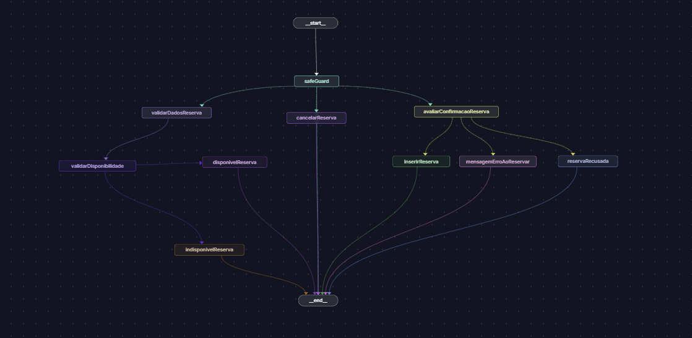

# ChatBot-Restaurante

API de chatbot para atendimento e gerenciamento de reservas de restaurante,
desenvolvida com Node.js, TypeScript, Fastify, LangGraph e LangChain/OpenRouter.

O assistente coleta nome, quantidade de pessoas e data/horário, valida a
disponibilidade no MySQL, solicita confirmação ao cliente e permite cadastrar
ou cancelar reservas.

## Funcionalidades

- Extração estruturada dos dados da reserva.
- Solicitação dos dados ainda não informados pelo cliente.
- Verificação de disponibilidade por data e horário.
- Confirmação explícita antes da criação da reserva.
- Cadastro e cancelamento persistidos no MySQL.
- Classificação de segurança das mensagens antes do processamento.
- Continuação de uma conversa por meio do estado enviado pela API.

## Tecnologias

- Node.js
- TypeScript
- Fastify
- LangGraph
- LangChain
- OpenRouter
- MySQL / mysql2
- Zod
- tsx

## Pré-requisitos

- Node.js 20 ou superior
- npm
- Uma chave de API da OpenRouter
- Uma instância de MySQL

## Foto do LangSmith



## Configuração

### 1. Instalar as dependências

```bash
npm install
```

### 2. Configurar o ambiente

Copie o arquivo de exemplo:

```bash
cp .env.example .env
```

No Windows, o arquivo pode ser copiado manualmente pelo Explorer.

Configure o `.env`:

```dotenv
# Modelo e API
OPENROUTER_API_KEY=sua-chave-openrouter

# Banco de dados MySQL
DB_HOST=127.0.0.1
DB_PORT=3306
DB_USER=usuario
DB_PASSWORD=sua-senha
DB_NAME=chatbot_restaurante

# Servidor HTTP (opcionais)
HOST=127.0.0.1
PORT=3000

# LangSmith (opcional)
LANGSMITH_API_KEY=sua-chave-langsmith
LANGCHAIN_TRACING_V2=true
LANGCHAIN_PROJECT=ChatBot-Restaurante
```

`DB_PASSWORD` pode ser omitida caso o usuário do MySQL não tenha senha.

### 3. Criar a tabela

Execute o script [BD/script.sql](BD/script.sql) no banco configurado:

```sql
CREATE TABLE IF NOT EXISTS Reservas (
    Id INT NOT NULL AUTO_INCREMENT,
    NomeReservado VARCHAR(255) NOT NULL,
    QtdDePessoas INT NOT NULL,
    DataHora DATETIME NOT NULL,
    PRIMARY KEY (Id)
);
```

## Executando

### API Fastify

```bash
npm run dev
```

Por padrão, o servidor fica disponível em `http://127.0.0.1:3000`.

### LangGraph local

```bash
npm run langgraph:serve
```

O grafo é identificado como `restaurante` em [langgraph.json](langgraph.json).

## API

### Criar ou continuar uma conversa

```http
POST /chat
Content-Type: application/json
```

Exemplo:

```json
{
  "message": "Meu nome é Ana. Quero uma mesa para 2 pessoas às 19h hoje."
}
```

#### Campos aceitos

| Campo | Tipo | Descrição |
| --- | --- | --- |
| `message` | string | Nova mensagem do usuário. Campo obrigatório. |
| `messages` | array | Histórico da conversa. |
| `nomeReservado` | string | Nome informado para a reserva. |
| `qtdePessoas` | integer | Quantidade de pessoas. |
| `dataHora` | string | Data e horário informados pelo usuário. |
| `confirmacaoReserva` | string | Estado: `aguardando`, `confirmada` ou `recusada`. |
| `idReserva` | integer | ID usado no cancelamento. |
| `sucesso` | boolean | Resultado da última etapa do fluxo. |
| `erro` | string | Mensagem da última etapa com erro. |

O histórico usa objetos com `role` igual a `human` ou `ai`:

```json
{
  "role": "human",
  "content": "Meu nome é Ana"
}
```

Para continuar uma conversa, reutilize o campo `messages` e os campos de estado
retornados pela resposta anterior.

### Confirmar uma reserva

Após o primeiro pedido, o assistente informa que a reserva está disponível e
aguarda uma resposta.

Envie uma confirmação com os dados estruturados e o histórico anterior:

```json
{
  "message": "Sim",
  "messages": [],
  "nomeReservado": "Ana",
  "qtdePessoas": 2,
  "dataHora": "19h hoje",
  "confirmacaoReserva": "aguardando"
}
```

Na integração real, `messages` deve conter o histórico devolvido pela resposta
anterior, em vez de um array vazio.

Uma confirmação cria a reserva no MySQL e a resposta inclui o ID de registro.
O registro pode ser usado posteriormente para cancelar a reserva.

### Cancelar uma reserva

Informe o ID na mensagem:

```bash
curl -X POST http://127.0.0.1:3000/chat ^
  -H "Content-Type: application/json" ^
  -d "{\"message\":\"Cancelar reserva ID 1\"}"
```

Ou envie o campo estruturado:

```json
{
  "message": "Cancelar minha reserva",
  "idReserva": 1
}
```

## Formatos de data e horário

O serviço de reservas reconhece formatos como:

- `19h`, `19:30` e `19h30`
- `7 da noite`
- `hoje`, `amanhã` e `depois de amanhã`
- `2026-12-31 20h`
- `31/12/2026 às 20h`
- `31 de dezembro às 20h`

Para interpretar corretamente a disponibilidade e o registro no banco, a
mensagem deve informar data e horário.

## Fluxo do LangGraph

O grafo segue os seguintes passos:

1. Executa a classificação de segurança.
2. Detecta pedidos de cancelamento.
3. Avalia respostas a uma confirmação pendente.
4. Valida nome, quantidade de pessoas e horário.
5. Consulta a disponibilidade no MySQL.
6. Pede confirmação ao cliente.
7. Cria ou recusa a reserva conforme a resposta.

A implementação principal está em [src/graph/graph.ts](src/graph/graph.ts).

## Estrutura do projeto

```text
src/
├── index.ts                 # Inicialização do servidor Fastify
├── config/
│   ├── database.ts          # Pool de conexão com MySQL
│   └── model.ts             # Configuração do modelo OpenRouter
├── routes/chat.ts           # Rota POST /chat
├── graph/
│   ├── graph.ts             # Grafo e transições LangGraph
│   ├── state.ts             # Estado e schema Zod
│   └── nodes/               # Etapas do fluxo de atendimento
└── services/reservas.ts     # Operações de disponibilidade e reservas
BD/
└── script.sql               # Criação da tabela Reservas
```

## Validação

Não há scripts de testes ou build definidos no `package.json`. Para verificar a
tipagem:

```bash
npx tsc --noEmit
```

## LangSmith

As variáveis `LANGSMITH_API_KEY`, `LANGCHAIN_TRACING_V2` e
`LANGCHAIN_PROJECT` são opcionais e ativam o rastreamento das execuções no
LangSmith.


## Licença

Este projeto está licenciado sob a licença MIT. Consulte [LICENSE](LICENSE).
