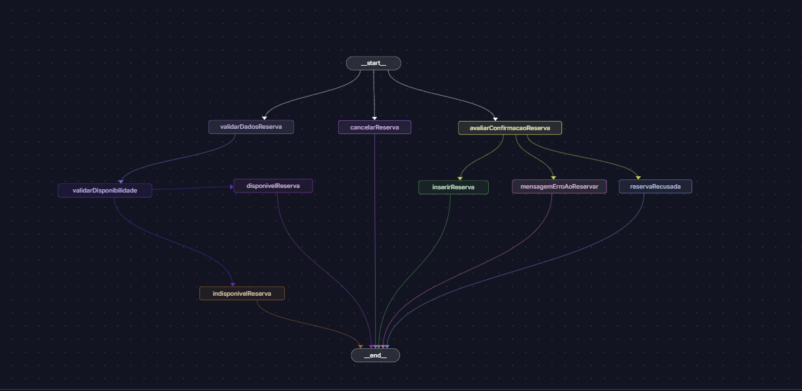

# ChatBot-Restaurante v2

API de chatbot para atendimento e reservas de restaurante, desenvolvida em
Node.js com Fastify, TypeScript, LangGraph e LangChain/OpenRouter.

O projeto coleta os dados da reserva, valida disponibilidade, pede confirmação
ao cliente e permite cadastrar ou cancelar reservas em memória.

## Funcionalidades

- Extração de nome, quantidade de pessoas e horário a partir da conversa.
- Solicitação dos dados que ainda não foram informados.
- Verificação de conflito de horário.
- Confirmação explícita antes da criação da reserva.
- Cancelamento de reserva pelo ID de registro.
- Manutenção do histórico e dos dados da conversa entre as requisições da API.

> As reservas são armazenadas em memória. Reiniciar o servidor remove todas as
> reservas cadastradas.

## Tecnologias

- Node.js
- TypeScript
- Fastify
- LangGraph
- LangChain
- OpenRouter
- Zod
- tsx

## Pré-requisitos

- Node.js 20 ou superior
- npm
- Chave de API da OpenRouter

## Foto do LangSmith



## Configuração

1. Instale as dependências:

```bash
npm install
```

2. Crie o arquivo de ambiente a partir do modelo:

```bash
cp .env.example .env
```

No Windows, caso o comando `cp` não esteja disponível, copie manualmente o
arquivo `.env.example` para `.env`.

3. Configure as variáveis em `.env`:

```dotenv
OPENROUTER_API_KEY=sua-chave

# Variáveis opcionais para observabilidade no LangSmith
LANGSMITH_API_KEY=sua-chave-langsmith
LANGCHAIN_TRACING_V2=true
LANGCHAIN_PROJECT=ChatBot-Restaurante
```

As variáveis `LANGSMITH_API_KEY`, `LANGCHAIN_TRACING_V2` e
`LANGCHAIN_PROJECT` são opcionais.

## Executando o projeto

### API Fastify

```bash
npm run dev
```

Por padrão, o servidor fica disponível em `http://127.0.0.1:3000`.

O host e a porta podem ser alterados:

```dotenv
HOST=0.0.0.0
PORT=3000
```

### LangGraph local

```bash
npm run langgraph:serve
```

O grafo configurado em `langgraph.json` é identificado como `restaurante`.

## API

### Criar ou continuar uma conversa

```http
POST /chat
Content-Type: application/json
```

Corpo da requisição:

```json
{
  "message": "Quero reservar uma mesa para 4 pessoas às 19h"
}
```

Campos opcionais usados para continuar o estado da conversa:

| Campo | Tipo | Descrição |
| --- | --- | --- |
| `messages` | array | Histórico convertido em mensagens human/AI |
| `nomeReservado` | string | Nome informado para a reserva |
| `qtdePessoas` | integer | Quantidade de pessoas |
| `dataHora` | string | Data ou descrição de horário informada pelo usuário |
| `confirmacaoReserva` | string | `aguardando`, `confirmada` ou `recusada` |
| `idReserva` | integer | ID usado no cancelamento |
| `sucesso` | boolean | Resultado da última etapa do fluxo |
| `erro` | string | Mensagem de erro da última etapa |

Para continuar uma conversa, envie o campo `messages` e os campos de estado
retornados pela resposta anterior junto com a nova `message`.

Exemplo de histórico:

```json
{
  "role": "human",
  "content": "Meu nome é Ana"
}
```

Mensagens válidas possuem `role` igual a `human` ou `ai`.

### Exemplo de reserva

Primeira mensagem:

```bash
curl -X POST http://127.0.0.1:3000/chat ^
  -H "Content-Type: application/json" ^
  -d "{\"message\":\"Meu nome é Ana. Quero uma mesa para 2 pessoas às 19h hoje.\"}"
```

Se o horário estiver disponível, o assistente retorna a pergunta:

```text
Reserva disponível! Deseja confirmar a reserva? Responda sim ou não.
```

Confirme explicitamente em outra requisição:

```json
{
  "message": "Sim",
  "nomeReservado": "Ana",
  "qtdePessoas": 2,
  "dataHora": "19h hoje",
  "messages": [],
  "confirmacaoReserva": "aguardando"
}
```

É necessário reutilizar o `messages` retornado pela resposta anterior. O
campo `messages` vazio no exemplo foi mantido apenas para ilustrar o formato.

Após a confirmação, o assistente cria a reserva em memória e retorna o ID de
registro para possível cancelamento.

### Cancelamento

Envie o pedido de cancelamento junto com o ID da reserva:

```bash
curl -X POST http://127.0.0.1:3000/chat ^
  -H "Content-Type: application/json" ^
  -d "{\"message\":\"Cancelar reserva 1\",\"idReserva\":1}"
```

O ID também pode ser informado na mensagem, por exemplo:
`Cancelar reserva ID 1`.

## Fluxo do LangGraph

O grafo inicia a partir da mensagem do usuário e pode seguir pelos seguintes
estados:

1. Detecta um pedido de cancelamento.
2. Avalia uma resposta de confirmação pendente.
3. Valida nome, quantidade de pessoas e horário.
4. Verifica a disponibilidade.
5. Pede confirmação ao cliente.
6. Cria ou recusa a reserva conforme a resposta.

A implementação do grafo está em
[`src/graph/graph.ts`](src/graph/graph.ts).

## Estrutura do projeto

```text
src/
├── index.ts                 # Inicialização do servidor Fastify
├── config/model.ts          # Configuração do modelo OpenRouter
├── routes/chat.ts           # Rota POST /chat
├── graph/
│   ├── graph.ts             # Grafo e transições LangGraph
│   ├── state.ts             # Estado e validação Zod
│   └── nodes/               # Etapas do fluxo de atendimento
└── services/reservas.ts     # Armazenamento e disponibilidade em memória
```

## Validação

Não há scripts de teste ou build definidos no `package.json`. Para verificar a
tipagem do projeto:

```bash
npx tsc --noEmit
```

## Licença

Este projeto está licenciado sob a licença MIT. Consulte o arquivo
[`LICENSE`](LICENSE).
